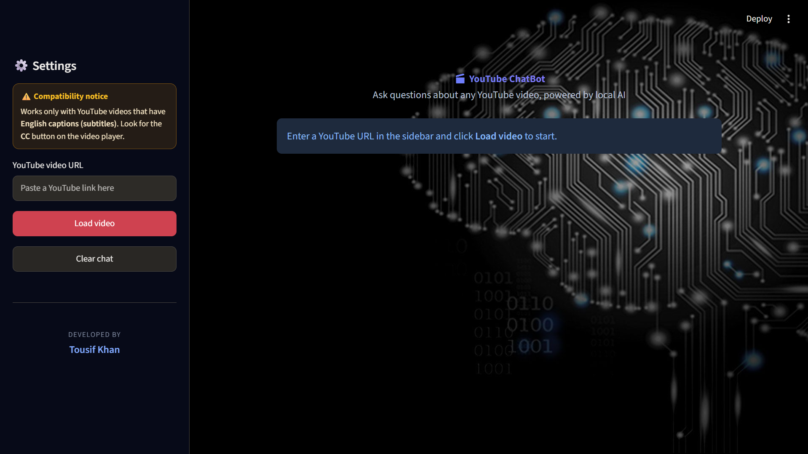
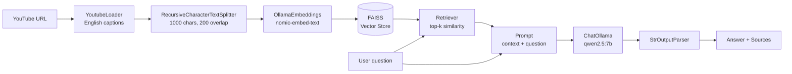

<div align="center">

#  YouTube ChatBot using LangChain

**Chat with any YouTube video. Private, free, and 100% local.**

A Retrieval-Augmented Generation (RAG) app built with LangChain, Ollama, FAISS and Streamlit.
No API keys. No cloud. Your data never leaves your machine.


</div>

---

##  Demo



---

##  Table of contents

- [Overview](#-overview)
- [Features](#-features)
- [Architecture](#-architecture)
- [Tech stack](#-tech-stack)
- [Prerequisites](#-prerequisites)
- [Installation](#-installation)
- [Usage](#-usage)
- [Project structure](#-project-structure)
- [How it works](#-how-it-works)
- [Configuration](#-configuration)
- [Troubleshooting](#-troubleshooting)
- [Limitations](#-limitations)
- [Roadmap](#-roadmap)
- [Contributing](#-contributing)
- [License](#-license)
- [Author](#-author)
- [Acknowledgments](#-acknowledgments)

---

##  Overview

**YouTube ChatBot** lets you paste a YouTube link and ask questions about the video in plain language.
It reads the video's English captions, splits them into chunks, converts them into vector embeddings,
and retrieves the most relevant parts to answer your question with a local language model.

Everything runs on your own computer using [Ollama](https://ollama.com), so there are no API costs
and no data is sent to external AI services.

##  Features

-  **Paste any YouTube link**: standard, `youtu.be`, shorts and embed links are all cleaned automatically
-  **100% local AI**: chat model `qwen2.5:7b` and embeddings `nomic-embed-text` through Ollama
-  **Zero cost**: no OpenAI or other paid API key required
-  **Private**: video content and questions stay on your machine
-  **Grounded answers**: the bot answers only from the video; if the answer isn't there, it says it doesn't know
-  **Source transparency**: each answer comes with an expandable *Sources used* section
-  **Polished UX**: animated loading state, clean ready message, dark glass-style interface
-  **Chain-based design**: built with LangChain Runnables (`RunnableParallel`, `|` pipe syntax)

##  Architecture



##  Tech stack

| Layer | Technology |
|---|---|
| Framework | LangChain |
| Local LLM runtime | Ollama |
| Chat model | `qwen2.5:7b` |
| Embedding model | `nomic-embed-text` |
| Vector store | FAISS (CPU) |
| Transcript loading | `YoutubeLoader` + `youtube-transcript-api` |
| Frontend | Streamlit with custom CSS |
| Language | Python 3.10+ |

##  Prerequisites

- **Python 3.10 or newer**
- **[Ollama](https://ollama.com/download)** installed and running
- **About 8 GB of free RAM** for the 7B model (CPU works, GPU makes it faster)
- An **internet connection** for the first run (to download packages and fetch captions)
- A YouTube video with **English captions** (look for the **CC** button)

##  Installation

**1. Clone the repository**

```bash
git clone https://github.com/tousifkhan4890/youtube-chatbot-langchain-ollama.git
cd youtube-chatbot-langchain-ollama
```

**2. Create and activate a virtual environment**

```bash
# Windows (PowerShell)
python -m venv venv
venv\Scripts\activate

# macOS / Linux
python3 -m venv venv
source venv/bin/activate
```

**3. Install dependencies**

```bash
pip install -r requirements.txt
```

**4. Download the local models**

```bash
ollama pull qwen2.5:7b
ollama pull nomic-embed-text
```

Check that both are installed:

```bash
ollama list
```

##  Usage

1. Make sure Ollama is running (open the Ollama app or run `ollama serve`).
2. Start the app:

   ```bash
   streamlit run app.py
   ```

3. Open `http://localhost:8501` in your browser.
4. Paste a YouTube link in the sidebar and click **Load video**.
5. Wait for the green **Video ready** message, then ask your questions.

**Example questions**

- What is this video about?
- What are the main takeaways?
- What did the speaker say about *[topic]*?
- Does the video mention *[keyword]*?

> Tip: specific questions give better answers than broad ones like "summarize everything".

##  Project structure

```
youtube-chatbot-langchain-ollama/
├── .streamlit/
│   └── config.toml        # Dark theme and primary color
├── assets/
│   └── screenshot.png     # Demo screenshot used in this README
├── app.py                 # Streamlit app: UI + RAG pipeline
├── background.jpg         # Background image for the UI
├── requirements.txt       # Python dependencies
├── .gitignore             # Files excluded from version control
├── LICENSE                # MIT license
└── README.md              # Project documentation
```

##  How it works

1. **Ingestion**: `YoutubeLoader` downloads the English captions of the video.
2. **Splitting**: `RecursiveCharacterTextSplitter` cuts the text into 1000-character chunks with 200 characters of overlap so context isn't lost at the edges.
3. **Embedding**: each chunk is converted into a vector by `nomic-embed-text` running in Ollama.
4. **Indexing**: vectors are stored in an in-memory **FAISS** index.
5. **Retrieval**: for each question, the 4 most similar chunks are fetched (`k=4`).
6. **Augmentation**: the chunks and the question are placed into a prompt that tells the model to answer only from the provided context.
7. **Generation**: `qwen2.5:7b` writes the final answer, and the app shows the source chunks used.

The chain is built with LangChain Expression Language:

```python
parallel_chain = RunnableParallel({
    "context": retriever | RunnableLambda(format_docs),
    "question": RunnablePassthrough(),
})
main_chain = parallel_chain | prompt | llm | StrOutputParser()
```

##  Configuration

Edit these values in `build_chain()` inside `app.py`:

| Setting | Default | What it does |
|---|---|---|
| `chunk_size` | `1000` | Size of each text chunk (characters) |
| `chunk_overlap` | `200` | Characters shared between neighboring chunks |
| `k` | `4` | Number of chunks retrieved per question (try `8` for broader answers) |
| `temperature` | `0.2` | Lower is more factual, higher is more creative |
| `language` | `["en"]` | Caption language requested from YouTube |
| `model` (chat) | `qwen2.5:7b` | Any chat model you have pulled in Ollama |
| `model` (embeddings) | `nomic-embed-text` | Any embedding model you have pulled in Ollama |

To change the background, replace `background.jpg` with your own image.

##  Troubleshooting

| Problem | Likely cause | Fix |
|---|---|---|
| `Connection refused` | Ollama is not running | Open the Ollama app or run `ollama serve` |
| `Could not load the video` | Video has no English captions, or the link is invalid | Pick a video with the **CC** button and paste a full link |
| `RequestBlocked` / `IpBlocked` | YouTube temporarily blocked your IP | Wait 15 to 30 minutes or switch network |
| `cannot import name 'FetchedTranscript'` | Old `youtube-transcript-api` | `pip install -U "youtube-transcript-api>=1.0"` |
| Slow answers | Model running on CPU | Close other apps or use a smaller model |
| `pip` download times out | Weak connection | `pip install -r requirements.txt --default-timeout=200 --retries 10` |
| Streamlit command not found | Virtual environment not active | Activate `venv` first |

##  Limitations

- Works only with videos that have **English captions**.
- Answers depend on the 4 retrieved chunks, so very broad questions (like a full summary of a long video) can be incomplete.
- There is no conversation memory yet; each question is answered independently.
- Speed depends on your hardware because the model runs locally.

##  Roadmap

- [ ] Conversation memory so follow-up questions work
- [ ] Support for more caption languages
- [ ] Video preview inside the app
- [ ] Settings panel for `k` and temperature
- [ ] Download chat as text or PDF
- [ ] Suggested question buttons

##  Contributing

Contributions are welcome.

1. Fork the repository
2. Create a branch: `git checkout -b feature/your-feature`
3. Commit your changes: `git commit -m "Add your feature"`
4. Push the branch: `git push origin feature/your-feature`
5. Open a Pull Request

##  License

Distributed under the MIT License. See [`LICENSE`](LICENSE) for details.

##  Author

**Tousif Khan**

- GitHub: [@tousifkhan4890](https://github.com/tousifkhan4890)

##  Acknowledgments

- Built while learning Generative AI through the CampusX GenAI course
- [LangChain](https://www.langchain.com/), [Ollama](https://ollama.com/), [FAISS](https://github.com/facebookresearch/faiss) and [Streamlit](https://streamlit.io/) for the open-source tools that make this possible

---

<div align="center">

If you found this project useful, please consider giving it a ⭐

</div>
